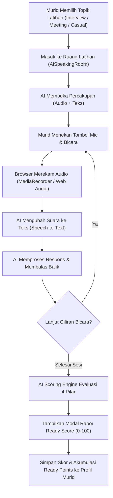
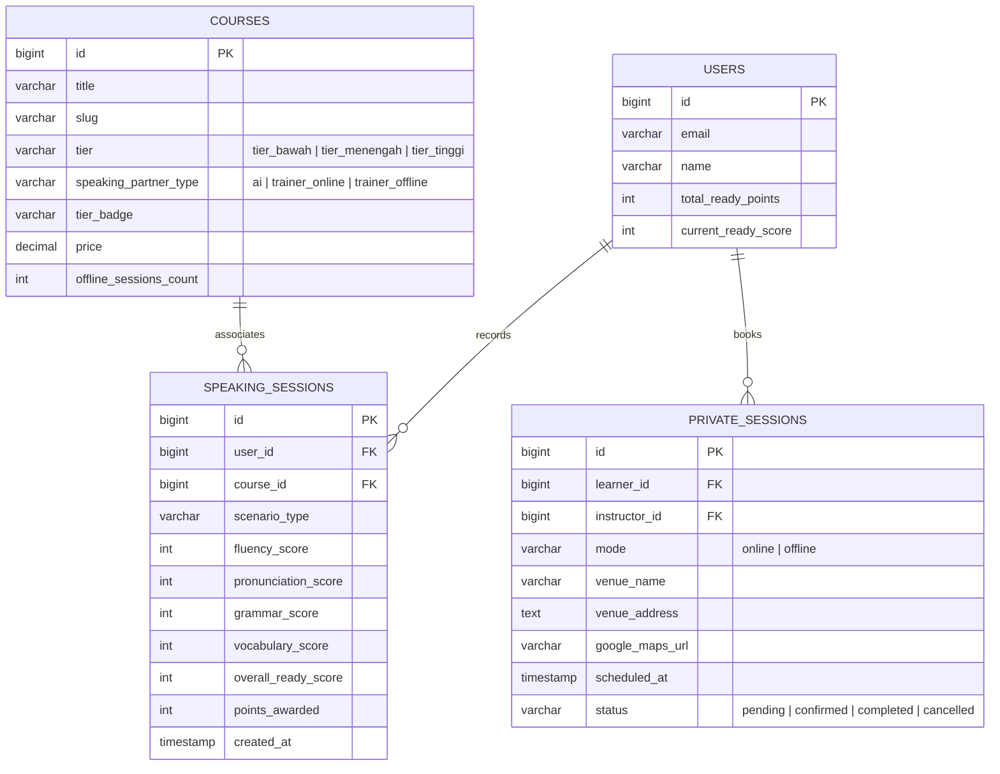

# Dokumentasi Implementasi & Spesifikasi Desain — English Ready

Dokumen ini memuat blueprint arsitektur, spesifikasi teknis, dan **bentuk visual desain (wireframe & mockup interaktif)** dari platform **English Ready** sesuai dengan acuan brand brief dan strategi pemaketan produk.

---

## 🎨 1. Sistem Desain & Identitas Visual Brand

| Atribut | Nilai / Kode Warna | Kegunaan |
| :--- | :--- | :--- |
| **Primary Brand (Deep Navy)** | `#0B2559` | Header, sidebar dashboard, judul utama, kartu paket utama |
| **Accent Primary (Electric Blue)** | `#0073F5` | Tombol CTA utama, status aktif, rekomendasi cohort, link |
| **Accent Secondary (Action Orange)**| `#F26A12` | Badge diskon hemat, penanda penting, tombol buat kelas |
| **Background Canvas (Warm Cream)** | `#FBF6F1` | Background landing page & dashboard (hangat & premium) |
| **Secondary Background** | `#FFFFFF` | Kontainer kartu, form dialog, card konten |
| **Border & Divider** | `#E6DED4` | Garis tepi kartu, border tabel, pemisah section |
| **Typography** | `Plus Jakarta Sans` | Font modern, clean, dan berstandar profesional |

---

## 📐 2. Bentuk Desain: Landing Page — Komparasi 3 Paket Utama (`#harga`)

Tiga kartu komparasi paket program dirancang vertikal sejajar dengan kartu **Paket Menengah** sebagai *hero/featured recommendation*.

### Visual Wireframe:

```text
+-------------------------------------------------------------------------------------------------------+
|                                        PILIHAN PAKET PROGRAM                                          |
|                     Investasi Terbaik untuk Kesiapan Bahasa Inggris Anda                              |
|                                                                                                       |
|  +-----------------------------+  +-----------------------------+  +-------------------------------+  |
|  | [Paket Bawah] [Self-Paced]  |  |   ⭐ PALING DIMINATI ⭐     |  | [Paket Tinggi] [Executive]   |  |
|  |                             |  | [Paket Menengah] [Cohort]   |  |                               |  |
|  | Ready Daily                 |  |                             |  | Ready Path Executive          |  |
|  | Latihan Mandiri & AI        |  | Cohort Ready for Work       |  | Executive 1-on-1 Offline      |  |
|  |                             |  | 6-Week Live Online Mentoring|  |                               |  |
|  | Rp 99.000 / bulan           |  |                             |  | Rp 2.690.000 / program        |  |
|  | Coret: Rp 199.000 (Hemat)   |  | Rp 1.490.000 / program      |  | Coret: Rp 3.490.000 (Hemat)   |  |
|  |                             |  | Coret: Rp 1.990.000 (Hemat) |  |                               |  |
|  | +-------------------------+ |  |                             |  | +---------------------------+ |  |
|  | | 🤖 PARTNER BICARA:     | |  | +-------------------------+ |  | | 📍 PARTNER BICARA:       | |  |
|  | | AI Speaking Partner 24/7| |  | | 💻 PARTNER BICARA:     | |  | | Trainer Tatap Muka       | |  |
|  | | Auto-scoring instan     | |  | | Live Trainer via Zoom   | |  | | (Offline) + Atur Lokasi | |  |
|  | +-------------------------+ |  | | Maks. 12 orang/kelompok | |  | +---------------------------+ |  |
|  |                             |  | +-------------------------+ |  |                               |  |
|  | FASILITAS:                  |  |                             |  | FASILITAS:                    |  |
|  | [✓] Materi Video Modul 24/7 |  | FASILITAS:                  |  | [✓] Semua Fasilitas Cohort + |  |
|  | [✓] AI Speaking Partner 24/7|  | [✓] Semua Fasilitas Paket   |  |     AI Speaking Partner       |  |
|  | [✓] Auto-scoring 4 pilar    |  |     Bawah (Video + AI)      |  | [✓] Sesi Privat 1:1 Tatap     |  |
|  | [✓] Komunitas WhatsApp Aktif|  | [✓] 6 Sesi Live Zoom 90 mnt |  |     Muka Offline Langsung     |  |
|  | [✓] Grafik Ready Points     |  | [✓] Live Feedback Trainer   |  | [✓] Fitur Bebas Pilih Lokasi  |  |
|  |                             |  | [✓] Tes Baseline & Exit     |  |     (Kafe/Coworking/Kantor)   |  |
|  |                             |  | [✓] Ready Certificate Resmi |  | [✓] Review Dokumen & CV       |  |
|  |                             |  | [✓] Opsi Cicilan 3x         |  |                               |  |
|  | [  Pilih Paket Bawah ->  ]  |  |                             |  | [  Pilih Paket Tinggi ->  ]   |  |
|  | [ Lihat 4 Kelas Bawah v  ]  |  | [  PILIH PAKET MENENGAH  ]  |  | [ Lihat 3 Kelas Tinggi v  ]   |  |
|  |                             |  | [ Lihat 5 Kelas Menengah v] |  |                               |  |
|  +-----------------------------+  +-----------------------------+  +-------------------------------+  |
+-------------------------------------------------------------------------------------------------------+
```

---

## 🗂️ 3. Bentuk Desain: Katalog Kelas & Tab Filter Interaktif (`#katalog-kelas`)

Tepat di bawah 3 kartu harga, terdapat bilah filter interaktif yang dapat menyaring kelas secara reaktif tanpa me-reload browser.

### Visual Wireframe Tab Filter & Banner:

```text
+-------------------------------------------------------------------------------------------------------+
|                                    KATALOG KELAS & SPESIALISASI                                       |
|                               Pilihan Kelas Sesuai Tingkatan Paket                                    |
|                                                                                                       |
|         [ 🌐 Semua Kelas (12) ]    [ 🥉 Paket Bawah (4) ]*   [ 🥈 Paket Menengah (5) ]   [ 🥇 Paket Tinggi (3) ]
|                                                                                                       |
|  +-------------------------------------------------------------------------------------------------+  |
|  | ℹ️  Fasilitas Paket Bawah: Akses Video Mandiri 24/7 + AI Speaking Partner Interaktif             |  |
|  |    Cocok bagi yang ingin fleksibilitas belajar kapan saja dengan evaluasi skor otomatis.         |  |
|  +-------------------------------------------------------------------------------------------------+  |
|                                                                                                       |
|  GRID KELAS (3 Kolom):                                                                                |
|                                                                                                       |
|  +----------------------------+  +----------------------------+  +----------------------------+       |
|  | [THUMBNAIL 16:9]           |  | [THUMBNAIL 16:9]           |  | [THUMBNAIL 16:9]           |       |
|  | [🥉 Paket Bawah] [Beginner]|  | [🥉 Paket Bawah] [Interm.] |  | [🥉 Paket Bawah] [All Lev] |       |
|  |----------------------------|  |----------------------------|  |----------------------------|       |
|  | [🤖 AI Speaking Partner 24/7|  | [🤖 AI Speaking Partner 24/7|  | [🤖 AI Speaking Partner 24/7|       |
|  | Ready Daily: Latihan       |  | Public Speaking in English:|  | Essential Skills Dev       |       |
|  | Mandiri & AI Partner       |  | Zero to Confident          |  | Professional Foundation    |       |
|  |                            |  |                            |  |                            |       |
|  | Instruktur: English Ready  |  | Instruktur: Sarah Jenkins  |  | Instruktur: Budi Santoso   |       |
|  |----------------------------|  |----------------------------|  |----------------------------|       |
|  | Investasi:                 |  | Investasi:                 |  | Investasi:                 |       |
|  | Rp 99.000  [Lihat Detail ->]  Rp 99.000  [Lihat Detail ->]  Rp 99.000  [Lihat Detail ->]       |       |
|  +----------------------------+  +----------------------------+  +----------------------------+       |
+-------------------------------------------------------------------------------------------------------+
```

---

## 🛠️ 4. Bentuk Desain: Form Instruktur (Create & Edit Course)

Memastikan instruktur menentukan tingkatan paket dan mendapatkan rekomendasi harga yang tepat saat membuat atau mengedit kelas.

### Visual Wireframe Modal:

```text
+-------------------------------------------------------------+
| Create New Course / Edit Course Details                 [X] |
+-------------------------------------------------------------+
| Title                                                       |
| [ Business English for Tech Leaders                       ] |
|                                                             |
| Slug                                                        |
| [ business-english-tech-leaders                           ] |
|                                                             |
| Level Kemampuan                                             |
| [ Intermediate (Menengah)                                v] |
|                                                             |
| Tingkatan Paket Program (Tier)       [💻 Live Trainer Zoom] |
| [ 🥈 Paket Menengah (Live Online Zoom Cohort)           v] |
| * Kelas kelompok intensif 6 minggu (maks. 12 murid) via Zoom|
|                                                             |
| Short Description                                           |
| [ Kuasai komunikasi meeting, standup, dan pitch deck...   ] |
|                                                             |
| Harga Kursus (IDR)       Saran: Rp 799.000 – Rp 1.990.000   |
| [ 1490000                                                 ] |
| (Jika di luar rentang: ⚠️ Harga di luar rentang rekomendasi)|
|                                                             |
| Thumbnail                                                   |
| [ Choose File ] course-thumb.jpg                            |
|                                                             |
|               [ Batal ]  [ Simpan Perubahan Kelas ]         |
+-------------------------------------------------------------+
```

---

## 🎙️ 5. Bentuk Desain: Tiket ER-102 — AI Speaking Practice Partner (`AiSpeakingRoom.tsx`)

Fitur utama latihan percakapan mandiri interaktif 24/7 dengan mikrofon browser, transkrip real-time, balasan audio AI, dan mesin penilaian instan.

### Alur Kerja Sistem (Mermaid Flowchart):



### Visual Wireframe: Kamar Latihan Bicara (`/dashboard/speaking`):

```text
+-------------------------------------------------------------------------------------------------------+
|  <- Kembali ke Dashboard     AI SPEAKING PARTNER ROOM                     Sesi: Job Interview Prep    |
+-------------------------------------------------------------------------------------------------------+
|  Topik: "Tell Me About Your Biggest Technical Challenge and How You Solved It"                       |
|                                                                                                       |
|  +-------------------------------------------------------------------------------------------------+  |
|  | 🤖 AI Coach (Sarah):                                                                            |  |
|  | "Hi Alex! Thanks for coming today. Could you walk me through a challenging bug or architecture |  |
|  |  issue you faced in your previous project, and how you managed to resolve it?"                  |  |
|  | [🔊 Putar Ulang Suara AI]                                                                      |  |
|  +-------------------------------------------------------------------------------------------------+  |
|                                                                                                       |
|                                    +---------------------------------------------------------------+  |
|                                    | 👤 Kamu:                                                      |  |
|                                    | "In my last project, we experienced a major memory leak in our|  |
|                                    |  Node.js service during flash sale. I used heap profiler..."  |  |
|                                    | ⏱️ Durasi: 42 detik                                          |  |
|                                    +---------------------------------------------------------------+  |
|                                                                                                       |
|  +-------------------------------------------------------------------------------------------------+  |
|  | 🤖 AI Coach (Sarah):                                                                            |  |
|  | "Impressive approach. How did you communicate the downtime risk to the stakeholders?"          |  |
|  | [🔊 Putar Ulang Suara AI]                                                                      |  |
|  +-------------------------------------------------------------------------------------------------+  |
|                                                                                                       |
|-------------------------------------------------------------------------------------------------------|
|  KONTROL INTERAKSI BICARA:                                                                            |
|                                                                                                       |
|               Visualizer Gelombang Suara:  |||l|l|||||||l||l|||l|||   [ 00:35 ]                      |
|                                                                                                       |
|                     [ 🔴 SEDANG MEREKAM... KLIK UNTUK KIRIM RESPONS ]                                 |
|                                                                                                       |
|         [ 🔄 Ganti Topik Skenario ]                      [ ⏹️ Selesaikan Sesi & Hitung Skor ]         |
+-------------------------------------------------------------------------------------------------------+
```

### Visual Wireframe: Rapor Evaluasi Skor Instan (Scoring Modal):

```text
+--------------------------------------------------------------------+
| 🏆 SESI LATIHAN SELESAI — HASIL EVALUASI READY SCORE               |
+--------------------------------------------------------------------+
|                                                                    |
|               OVERALL READY SCORE:  86 / 100                       |
|               Tingkat Kesiapan: Professional Fluent                |
|               🎉 Selamat! Kamu mendapatkan +50 Ready Points!       |
|                                                                    |
|  4 PILAR PENILAIAN AI:                                             |
|                                                                    |
|  1. Fluency & Pace (Kelancaran & Tempo Bicara):     [ 88 / 100 ]   |
|     =======================================>-------                |
|     Feedback: Ritme bicara natural, jeda berpikir minim.           |
|                                                                    |
|  2. Pronunciation & Clarity (Kejelasan Pelafalan):  [ 82 / 100 ]   |
|     =================================>-------------                |
|     Catatan: Perbaiki artikulasi kata: 'architecture', 'resolved'. |
|                                                                    |
|  3. Grammar Accuracy (Ketepatan Tata Bahasa):       [ 85 / 100 ]   |
|     =====================================>---------                |
|     Koreksi: "In my last project" -> Sudah tepat.                  |
|     Saran: Gunakan past continuous untuk mendeskripsikan kejadian. |
|                                                                    |
|  4. Vocabulary Variety (Kekayaan Kosakata Kerja):   [ 90 / 100 ]   |
|     =========================================>-----                |
|     Pujian: Kosakata teknis sangat relevan (heap profiler, outage).|
|                                                                    |
|  +--------------------------------------------------------------+  |
|  | Rekomendasi Latihan Selanjutnya:                             |  |
|  | "Coba skenario Client Negotiation untuk melatih diplomasi."  |  |
|  +--------------------------------------------------------------+  |
|                                                                    |
|          [ 🔄 Latihan Topik Lain ]    [ 📊 Lihat Riwayat Progres ]  |
+--------------------------------------------------------------------+
```

---

## 📈 6. Bentuk Desain: Tiket ER-105 — Dashboard Progres Belajar (`/dashboard/progress`)

Halaman pemantauan perkembangan skor bahasa Inggris murid yang dihasilkan dari akumulasi latihan AI dan ujian.

### Visual Wireframe:

```text
+-------------------------------------------------------------------------------------------------------+
|  Dashboard > Progres Belajar Siswa                                                                    |
|                                                                                                       |
|  +-------------------------+  +-------------------------+  +---------------------------------------+  |
|  | READY SCORE RATA-RATA   |  | TOTAL READY POINTS      |  | STREAK LATIHAN BICARA                 |  |
|  |       84 / 100          |  |       1.250 Poin        |  |       🔥 7 Hari Berturut-turut        |  |
|  | +6 poin dari Baseline   |  | Level: Advanced Speaker |  | Target Mingguan: 5/5 sesi tercapai    |  |
|  +-------------------------+  +-------------------------+  +---------------------------------------+  |
|                                                                                                       |
|  GRAFIK PERKEMBANGAN SKOR MINGGUAN (4 PILAR):                                                         |
|  Skor                                                                                                 |
|  100 |                                            *--* (Fluency: 88)                                  |
|   80 |                         *---------*-------*     (Grammar: 85)                                  |
|   60 |              *---------*                        (Pronunciation: 82)                            |
|   40 |    *--------*                                                                                  |
|    0 +---------------------------------------------------------                                       |
|          Minggu 1        Minggu 2        Minggu 3    Minggu 4 (Hari Ini)                              |
|                                                                                                       |
|  RIWAYAT SESI LATIHAN TERAKHIR:                                                                       |
|  +------------------+------------------------------+------------+--------------+-------------------+  |
|  | Tanggal          | Skenario Topik               | Durasi     | Skor Sesi    | Ready Points      |  |
|  +------------------+------------------------------+------------+--------------+-------------------+  |
|  | 09 Nov 2026      | Job Interview Technical Prep | 06:15 mnt  | 86 / 100     | +50 Poin          |  |
|  | 07 Nov 2026      | Weekly Engineering Standup   | 04:30 mnt  | 84 / 100     | +40 Poin          |  |
|  | 05 Nov 2026      | Client Project Pitching      | 08:20 mnt  | 80 / 100     | +40 Poin          |  |
|  +------------------+------------------------------+------------+--------------+-------------------+  |
+-------------------------------------------------------------------------------------------------------+
```

---

## 📍 7. Bentuk Desain: Tiket ER-103 — Booking Sesi Tatap Muka Offline (Paket Tinggi)

Form booking pada menu `/dashboard/private-sessions` untuk murid Paket Tinggi menentukan titik temu langsung dengan trainer.

### Visual Wireframe:

```text
+--------------------------------------------------------------------+
| Book Private Mentoring Session                                 [X] |
+--------------------------------------------------------------------+
| Pilih Trainer / Coach:                                             |
| [ Sarah Jenkins, M.Ed (Senior Business English Coach)           v] |
|                                                                    |
| Format Pertemuan:                                                  |
| ( ) 💻 Online via Zoom                                             |
| (*) 📍 Tatap Muka Langsung (Offline In-Person)  <-- Paket Tinggi   |
|                                                                    |
| Titik Lokasi Pertemuan Tatap Muka:                                 |
| [ Pilihan Titik Rekomendasi Partner                             v] |
|   - CoHive Coworking Space, SCBD Jakarta Selatan                   |
|   - Starbucks Reserve, Senayan City                                |
|   - [Opsi Bebas] Tulis Alamat Kustom Kantor / Kafe Pilihan Sendiri |
|                                                                    |
| Alamat Lengkap & Catatan Tempat:                                   |
| [ Gedung Pacific Century Place Lt. 12, Jl. Jend Sudirman Kav 52.  ] |
| [ Catatan: Bertemu di lounge coworking area lantai 12.            ] |
|                                                                    |
| Pilih Tanggal & Slot Waktu:                                        |
| [ 14 November 2026                                              v] |
| [ 14:00 - 15:30 WIB (90 Menit)                                  v] |
|                                                                    |
| Pratinjau Peta Lokasi:                                             |
| +----------------------------------------------------------------+ |
| |  [ Google Maps Preview Embed: Pacific Century Place SCBD ]     | |
| +----------------------------------------------------------------+ |
|                                                                    |
|               [ Batal ]  [ Konfirmasi Booking Sesi Offline ]       |
+--------------------------------------------------------------------+
```

---

## ⚡ 8. Bentuk Desain: Tiket ER-104 — Modul "Ready Check" (Tes 60 Detik di Landing Page)

Komponen interaktif di beranda untuk calon murid mengetes kelancaran bahasa Inggris dan mendapatkan rekomendasi paket secara otomatis.

### Visual Wireframe:

```text
+-------------------------------------------------------------------------------------------------------+
|  READY CHECK — CEK KESIAPAN BAHASA INGGRIS KERJA KAMU (60 DETIK)                                      |
|  Gratis · Tanpa Perlu Kartu Kredit · Hasil Skor & Analisis Instan                                     |
|                                                                                                       |
|  +-------------------------------------------------------------------------------------------------+  |
|  | Pertanyaan 2 dari 3: Respon Situasi Kerja                                                       |  |
|  | "Your manager asks for an urgent update on a delayed project task. What would you say?"        |  |
|  |                                                                                                 |  |
|  | [ Tekan Mic & Ucapkan Jawabanmu Selama 20 Detik ]                                              |  |
|  |                ||||l||||||||l||l|||l|| [ 00:14 ]                                               |  |
|  |                                                                                                 |  |
|  | Atau pilih opsi respons cepat tertulis:                                                         |  |
|  | ( ) "I am sorry, I have not finished yet because it is difficult."                             |  |
|  | ( ) "We hit an unexpected blocker on the API sync, but I have a patch ready by 3 PM."           |  |
|  | ( ) "The task is delayed and someone else made an error."                                      |  |
|  +-------------------------------------------------------------------------------------------------+  |
|                                                                                                       |
|  HASIL EVALUASI DIAGNOSTIK KELUAR:                                                                    |
|  +-------------------------------------------------------------------------------------------------+  |
|  | Skor Ready Check Kamu: 64 / 100 (Level: Pre-Intermediate)                                       |  |
|  | Kendala Terdeteksi: Butuh latihan spontanitas bicara & pemilihan kosakata formal profesional.   |  |
|  |                                                                                                 |  |
|  | 🎯 Rekomendasi Paket Terbaik Untukmu:                                                           |  |
|  | **🥈 Paket Menengah (Cohort Ready for Work)**                                                   |  |
|  | Kenapa? Kamu butuh interaksi live kelompok & bimbingan koreksi langsung dari trainer manusia.   |  |
|  |                                                                                                 |  |
|  |                  [  Daftar Paket Menengah Sekarang (Hemat Rp 500.000) ->  ]                     |  |
|  +-------------------------------------------------------------------------------------------------+  |
+-------------------------------------------------------------------------------------------------------+
```

---

## 🗄️ 9. Matriks Skema Database (Tabel & Relasi)



---

*Dokumen ini merupakan panduan implementasi resmi UI/UX & arsitektur sistem English Ready.*

